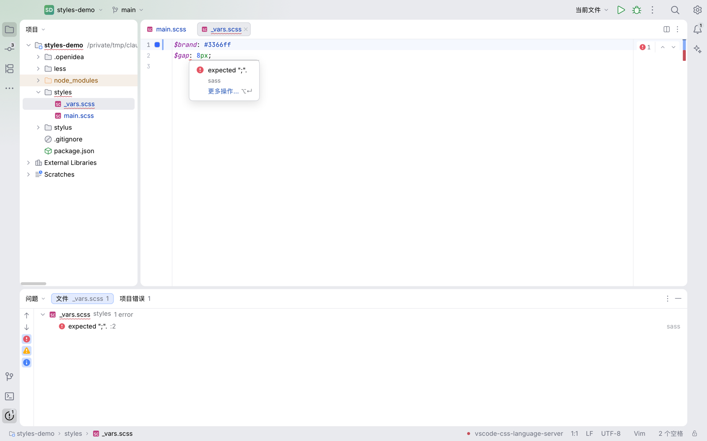
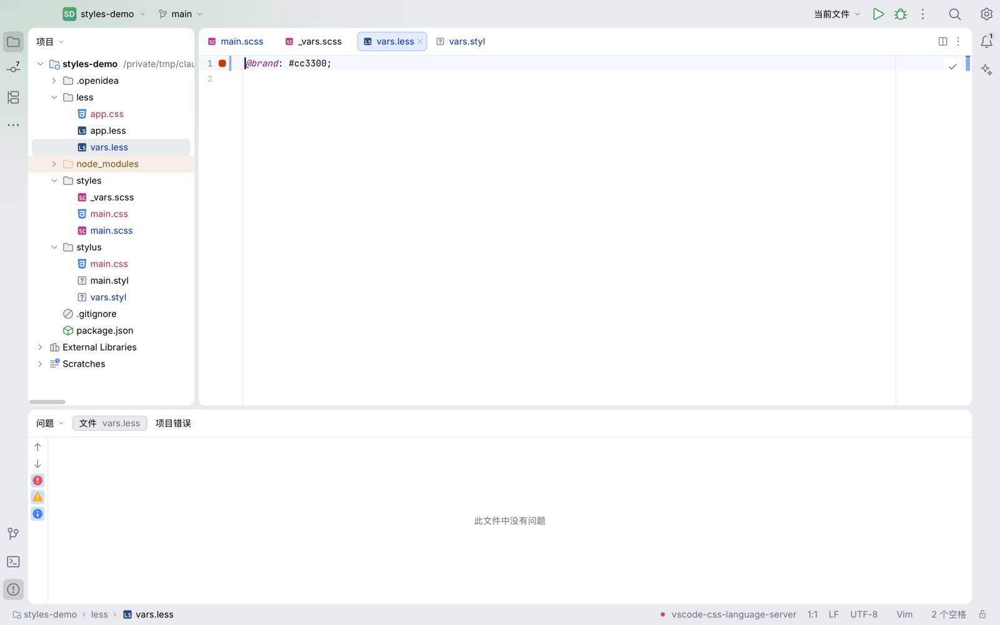
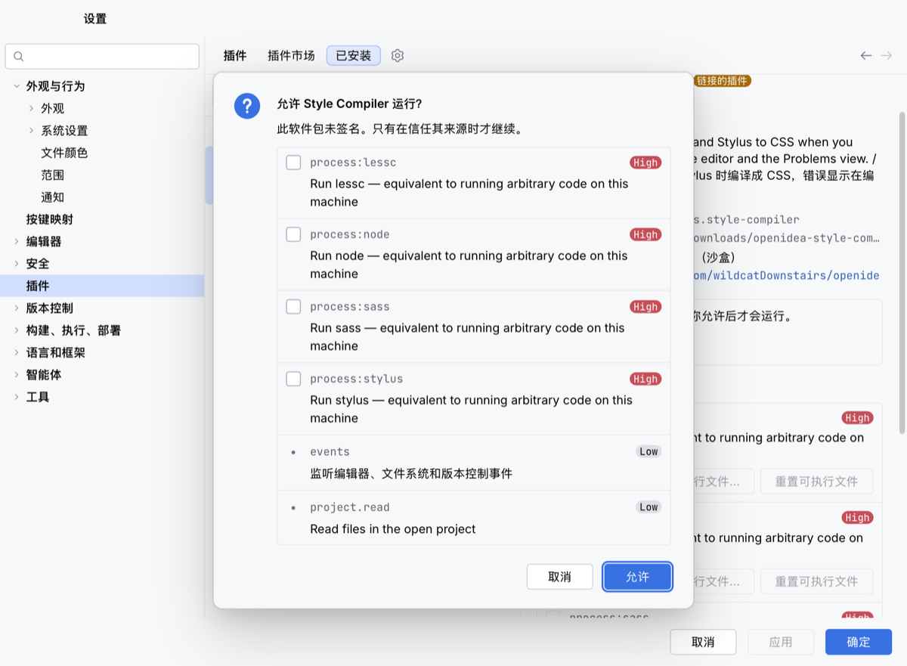
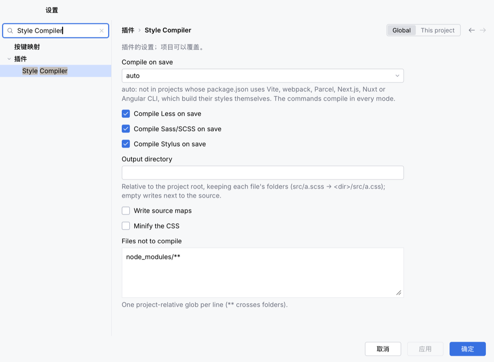

# OpenIDEA Style Compiler

[English](https://github.com/wildcatDownstairs/openidea-style-compiler/blob/main/README.md) · 简体中文

[OpenIDEA](https://github.com/l0ng-ai/openidea) 的样式预编译插件：保存 Less、Sass/SCSS、Stylus 文件时编译成 CSS，
编译错误显示在编辑器和 Problems 面板里。

- 用项目自己的编译器：从文件所在目录往上找 `node_modules/less`、`sass`、`stylus`，用 `node` 运行；
  项目里没有时改用全局的 `lessc` / `sass` / `stylus`
- 保存公共文件（Sass 的 `_vars.scss`、被别的文件引用的 `.less` / `.styl`）时，重新编译所有引用它的文件
- 错误标在出错的那个文件上；Sass 还会在诊断里附上「在哪里被引用」
- 项目用 Vite、webpack、Parcel、Next.js、Nuxt、Angular CLI 时默认不在保存时编译，这些工具自己会处理样式
- 命令：_Style Compiler: Compile Current File_、_Style Compiler: Compile All Stylesheets_

需要 OpenIDEA 0.1.49 及以后（插件 API 1.13）。





 

## 权限

| 权限 | 用途 |
| --- | --- |
| `project.read`、`events`（必需） | 读样式文件和 `package.json`，接收保存事件 |
| `process:node`（可选） | 运行项目 `node_modules` 里的编译器（推荐） |
| `process:lessc`、`process:sass`、`process:stylus`（可选） | 项目里没装编译器时，用全局安装的 |

只在受信任的项目里运行编译器。CSS 和 source map 由编译器自己写，插件不申请写文件权限。

## 安装

Settings › Plugins › Available 里搜索 Style Compiler 安装；或从
[Releases](https://github.com/wildcatDownstairs/openidea-style-compiler/releases) 下载 `.oiplugin`，
用 _Install Plugin from Package File…_ 安装。

## 设置

Settings › Plugins › Style Compiler，每一项都可以按项目覆盖。

| 设置 | 默认 | 说明 |
| --- | --- | --- |
| Compile on save | `auto` | `auto`：项目用了上面那些构建工具时保存不编译；`always`：总是编译；`off`：不编译。两个命令不受影响 |
| Compile Less / Sass/SCSS / Stylus on save | 开 | 按语言开关 |
| Output directory | 空 | 相对项目根目录，保留原来的目录结构（`src/a.scss` → `<目录>/src/a.css`）；空就写在源文件旁边 |
| Write source maps | 关 | |
| Minify the CSS | 关 | |
| Files not to compile | `node_modules/**` | 每行一个 glob |

## 目录

```
plugin.toml           清单
settings.schema.json  设置页
src/lib.rs            编译器查找、命令行参数、错误解析、诊断
src/graph.rs          引用关系：哪些文件引用了哪些文件
dist/plugin.wasm      构建产物（不提交，打包前 openidea-plugin build）
```

## 构建和测试

```bash
cargo test
```

```bash
openidea-plugin build    # → dist/plugin.wasm，并按安装时的规则检查
```

测试里用到的编译器错误输出，都是 less 4.9.1、sass 1.108.2、stylus 0.64.0 实际运行的结果。

## 在 IDE 里调试

```bash
openidea-plugin link .
```

`link` 默认写进正式版 IDE 的插件目录；只想链接到 `pnpm dev:app` 启动的开发版时，
设 `OPENIDEA_PLUGINS_DIR=<开发版的数据目录>/plugins`。改代码后重新 `openidea-plugin build`，
再在 Settings › Plugins 里 _Reload_。

## 发布

```bash
openidea-plugin build
```

```bash
openidea-plugin pack . --key <发布者私钥> --publisher wildcatdownstairs
```

把生成的 `wildcatdownstairs.style-compiler-<版本>.oiplugin` 附到 GitHub Release，
再向 [openidea-plugins](https://github.com/l0ng-ai/openidea-plugins) 提 PR 加上 `[[versions]]`。

## 已知限制

- Less 4.9.1 的 `lessc` 不能一次建出多级输出目录。用项目里的 Less 时插件会先建好目录；只能用全局 `lessc` 时，第一次编译到新的多级目录会报 `ENOENT`
- Sass 编译出错时会删掉上一次的 CSS；Less 和 Stylus 会保留
- 引用路径里带变量、通配符，或指向 `node_modules` 里的包时，不进依赖图，那些文件变了不会触发重新编译
- 两个入口文件都引用了同一个出错的公共文件时，公共文件上的诊断以最后一次编译为准
